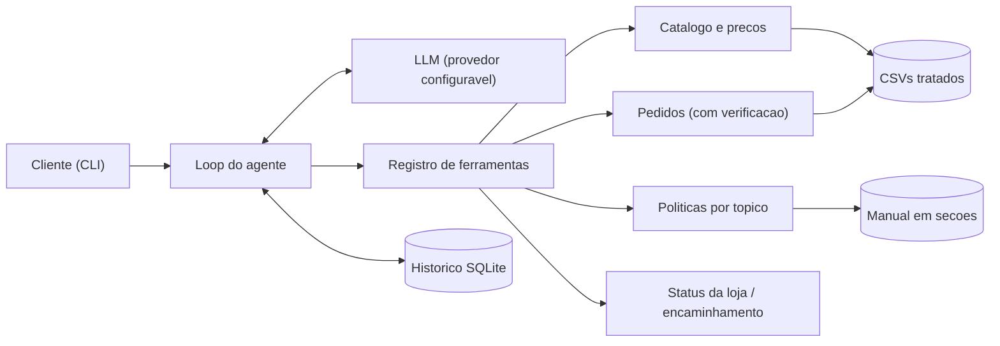
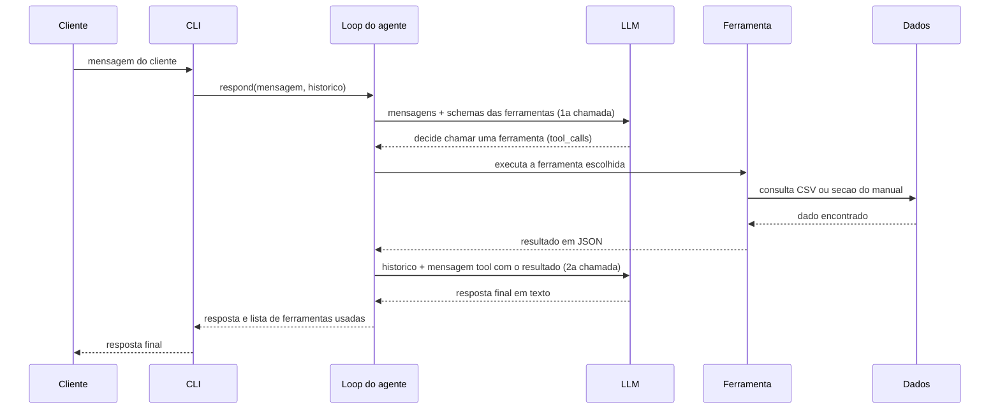
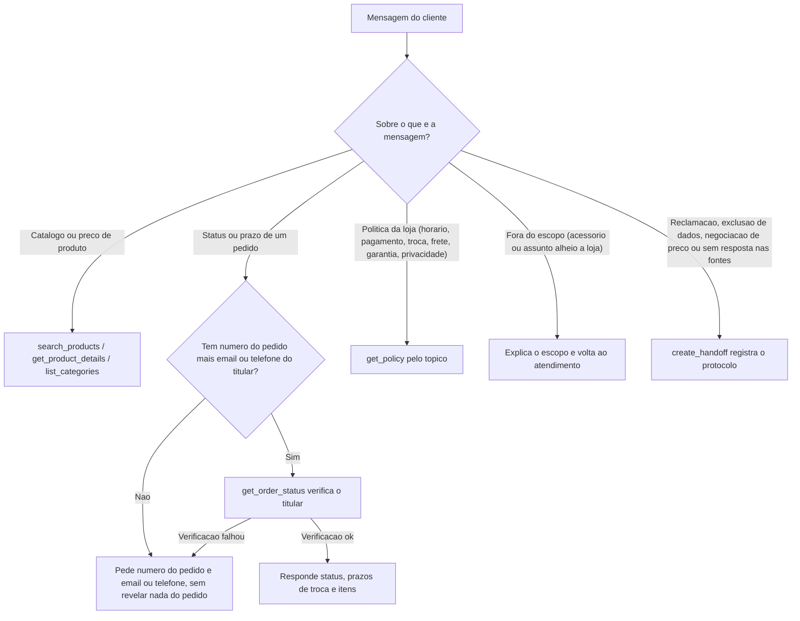
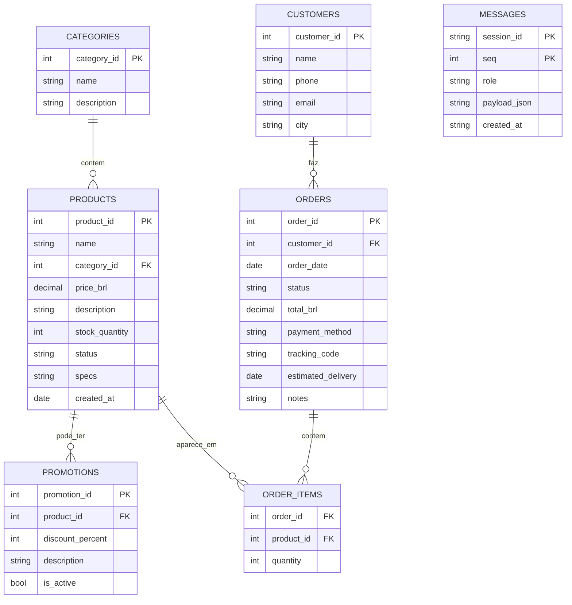

# Empório da Música — agente de atendimento

Protótipo de agente de atendimento por texto para a Empório da Música, loja fictícia de
instrumentos musicais em Campo Grande/MS. Responde dúvidas de catálogo, preço,
disponibilidade, status de pedido e políticas da loja a partir dos dados oficiais
(CSVs e manual de políticas), e encaminha para uma pessoa da equipe o que não pode
resolver sozinho.

## Índice

- [O que é](#o-que-é)
- [Como rodar](#como-rodar)
- [Arquitetura](#arquitetura)
- [Decisões técnicas](#decisões-técnicas)
- [Ferramentas do agente](#ferramentas-do-agente)
- [Premissas](#premissas)
- [Testes e avaliação](#testes-e-avaliação)
- [Limitações conhecidas e o que faria com mais tempo](#limitações-conhecidas-e-o-que-faria-com-mais-tempo)
- [Exemplos de conversa](#exemplos-de-conversa)
- [Estrutura do repositório](#estrutura-do-repositório)
- [Uso de assistentes de código](#uso-de-assistentes-de-código)

## O que é

O agente conversa em português, se apresenta pelo nome (Nina) e responde no tom de "um
amigo que entende de música" sobre o catálogo (busca, preço, promoção, disponibilidade),
o status de um pedido (com verificação do titular), as políticas da loja (horário,
pagamento, trocas, frete, garantia, privacidade) e sabe reconhecer o que está fora do
escopo da loja ou precisa de uma pessoa da equipe.

Todo dado de preço, estoque, prazo e status vem de uma ferramenta tipada chamada pelo
LLM — o modelo nunca calcula, nunca inventa e nunca repassa um número sem ter consultado
a fonte no mesmo turno ou num turno anterior da mesma sessão.

Uma conversa real, saída do comando `uv run emporio ask` sem nenhuma edição:

> **Cliente:** Vi uma promoção de 12% no Takamine GD20. Ainda vale?
>
> **Nina:** Oi! A promoção de 12 % no Takamine GD20 não está mais ativa. O preço atual é
> R$ 2 199,00 (ou R$ 2 089,05 no PIX, já com o desconto que oferecemos). Se quiser mais
> detalhes ou ver opções similares, é só falar!
>
> `· consultou: get_product_details`

O desconto de 12% que o cliente afirma **existe na base de dados**, mas numa promoção
inativa. O agente não o confirma: consulta a ferramenta, informa com transparência que a
promoção não está vigente e dá o preço atual, com o desconto do PIX que de fato se aplica.
Se tivesse aplicado a promoção vencida, teria respondido R$ 1.935,12. É esse tipo de erro
que a arquitetura existe para impedir.

## Como rodar

Pré-requisitos: Python 3.11+ e [`uv`](https://docs.astral.sh/uv/).

```bash
uv sync
cp .env.example .env     # e preencher LLM_API_KEY
uv run emporio chat
```

A chave gratuita do LLM (camada gratuita da [Groq](https://console.groq.com/keys),
modelo `openai/gpt-oss-120b`) é obtida em `console.groq.com/keys`, sem custo. Sem chave
nenhuma, o `.env.example` documenta a alternativa local com
[Ollama](https://ollama.com/) (`llama3.2:3b`): basta comentar as três linhas do Groq e
descomentar as três do Ollama, com o Ollama rodando localmente.

Outros comandos que existem de verdade:

- `uv run emporio ask "pergunta"` — um turno só, imprime a resposta no `stdout` e, se
  alguma ferramenta foi consultada, a lista no `stderr`.
- `uv run emporio sessions` — lista as sessões já gravadas.
- `uv run emporio chat --session ID` — retoma uma sessão específica; `--new` força uma
  sessão nova em vez de continuar a mais recente.
- `make check` ou `bash scripts/check.sh` — roda `ruff check`, `ruff format --check` e a
  suíte `pytest`. Esta máquina de desenvolvimento não tem `make` instalado; os scripts em
  `scripts/` fazem exatamente o que cada alvo do `Makefile` faz, então use-os diretamente
  se `make` não estiver disponível.
- `make policies` ou `bash scripts/policies.sh` — regenera `data/processed/politicas.json`
  a partir do PDF do manual.
- `make evals` ou `bash scripts/evals.sh` — avaliação contra o provedor real de LLM (ver
  [Testes e avaliação](#testes-e-avaliação)); aceita `--only E-02,E-05` e
  `--json caminho.json`.

## Arquitetura

### Componentes



### Sequência de uma mensagem com chamada de ferramenta



O resultado da ferramenta nunca volta como texto livre: entra na conversa como uma
mensagem de papel `tool`, amarrada por `tool_call_id` à chamada que o LLM pediu na
primeira ida. É só na segunda ida que o modelo recebe esse resultado e redige a
resposta final.

### Decisão



### Modelo de dados



`CATEGORIES`, `PRODUCTS`, `PROMOTIONS`, `ORDERS`, `ORDER_ITEMS` e `CUSTOMERS` vêm dos
CSVs em `data/raw/`. `MESSAGES` é a tabela do histórico de conversa (SQLite, chave
composta `session_id` + `seq`); não tem relação com as tabelas da loja, guarda a
conversa inteira por sessão. `email` em `CUSTOMERS` não é chave única — dois clientes
diferentes podem ter o mesmo e-mail cadastrado — por isso a verificação de titular usa
sempre o número do pedido junto com o e-mail ou telefone.

## Decisões técnicas

- **Function calling com ferramentas tipadas, não RAG vetorial nem SQL gerado pelo
  modelo.** A base é pequena (65 produtos, 20 pedidos) e o manual tem seções numeradas;
  busca por tópico já é exata e testável, sem precisar de embeddings. Mais importante:
  ferramenta tipada é o que permite exigir verificação de titular antes de devolver
  qualquer dado de pedido — com SQL gerado pelo modelo não haveria essa garantia.
- **Loop próprio, não framework de agentes.** Quatro dependências de runtime (`openai`,
  `pandas`, `python-dotenv`, `rich`) e controle total do fluxo, o que deixa o loop
  inteiramente testável com um LLM roteirizado (sequência fixa de respostas e chamadas
  de ferramenta), sem rede e sem chave.
- **LLM: `openai/gpt-oss-120b` na camada gratuita da Groq**, por um endpoint compatível
  com a API da OpenAI (troca de provedor é só variável de ambiente). O motivo é medido,
  não genérico: num projeto anterior de atendimento, um modelo local de 3B inventava
  informação e levava cerca de 8,5 segundos de mediana por resposta sem GPU, enquanto o
  120B hospedado acertou todos os cenários testados e respondeu em 0,4 a 0,9 segundo
  neste projeto. A alternativa local com Ollama fica documentada no `.env.example` para
  quem preferir não depender de rede.
- **Seções numeradas do manual em vez de RAG vetorial.** O manual de políticas tem 8
  páginas e seções numeradas; `get_policy` consulta por tópico (enum fixo de 11 valores)
  e devolve o texto literal da seção. É exato, testável e sem infraestrutura de busca —
  RAG vetorial passa a valer a pena com um corpus maior do que este.
- **Prompt de sistema enxuto, por orçamento de contexto.** O prompt de sistema mede 922
  tokens e os schemas das sete ferramentas, escritos à mão (não gerados), somam cerca de
  1.269 tokens — cerca de 2.190 tokens de base em toda requisição. Um turno que usa
  ferramenta gasta duas idas ao LLM, por volta de 4.400 tokens de entrada. A camada
  gratuita da Groq para este modelo dá 8.000 tokens de entrada por minuto, o que permite
  menos de dois turnos com ferramenta por minuto — por isso o prompt é curto e a janela
  de histórico enviada ao modelo é limitada, em vez de mandar a sessão inteira. Nenhuma
  regra de negócio numérica entra no texto do prompt: há um teste que falha se "7 dias",
  "30 dias", "90", "12x", "5%" ou "R$" aparecerem no prompt renderizado — todo número que
  o cliente vê precisa ter vindo de uma ferramenta no turno.
- **Schema de ferramenta escrito à mão, não gerado a partir da assinatura da função.**
  Schema gerado automaticamente tende a vir mais verboso e a gastar mais tokens de
  entrada em toda requisição; escrito à mão, as sete ferramentas somam os ~1.269 tokens
  citados acima. O risco de o schema divergir da assinatura real do `handler` é coberto
  por um teste de conformidade que varre o registro com `inspect.signature` e compara
  contra os parâmetros declarados.
- **Histórico em SQLite por `session_id`**, com as mensagens de ferramenta (`tool`)
  persistidas junto com as de `user` e `assistant` — é o que permite retomar uma sessão
  sem perder o contexto do que já foi consultado. A janela enviada ao LLM é limitada às
  mensagens mais recentes (orçamento de contexto), mas o corte nunca deixa uma mensagem
  `tool` órfã da `assistant` com `tool_calls` que a pediu: se o corte ingênuo cairia no
  meio de um bloco assim, a janela avança até a próxima mensagem `user`.
- **CLI interativa com `rich`** que mostra, numa linha discreta depois da resposta,
  quais ferramentas foram consultadas naquele turno (`· consultou: get_product_details`).
  É a transparência que deixa visível que o agente não está inventando o número que
  acabou de citar.
- **`Decimal`, nunca `float`, para dinheiro.** Preço e total de pedido são lidos do texto
  da célula do CSV direto para `Decimal`; nunca passam por `float`, para não introduzir
  erro de arredondamento no valor mostrado ao cliente.
- **`status` do produto tem precedência sobre o estoque** na classificação de
  disponibilidade: um produto `discontinued` ou `coming_soon` nunca aparece como
  disponível, mesmo com estoque positivo — o catálogo real tem casos assim (produto
  descontinuado com estoque 13, produto "em breve" com estoque 2).
- **O `total_brl` do pedido nunca é recalculado a partir dos itens.** É o valor
  histórico da compra; o catálogo pode divergir dele (desconto aplicado na época,
  promoção que não existia ou que já não vale mais).
- **Valor que não se aplica ao caso é negado explicitamente, nunca omitido.** Esta regra
  nasceu de um defeito real encontrado pela avaliação (ver
  [Testes e avaliação](#testes-e-avaliação)): a ferramenta de pedido omitia o preço no
  PIX quando havia promoção ativa (porque os dois não se acumulam), e a omissão
  convidou o modelo a calcular o valor por conta própria. Desde então, qualquer campo
  que não se aplica — preço no PIX com promoção ativa, código de rastreio antes do
  despacho, previsão de entrega antes do despacho — vem como uma mensagem explicando o
  motivo, nunca como um campo ausente.

## Ferramentas do agente

| Ferramenta | Entrada | Obrigatórios | O que devolve |
|---|---|---|---|
| `search_products` | `query`, `category`, `min_price`, `max_price`, `only_available`, `limit` | — | lista de produtos com id, nome, categoria, preço final, promoção e disponibilidade; se a categoria existe mas não tem item, lista vazia com `category_empty=true` |
| `get_product_details` | `product_id`, `name` | um dos dois | detalhes e especificações do produto, disponibilidade, condições de pagamento (PIX, parcelamento, combinação de formas) e até 3 alternativas se estiver indisponível |
| `list_categories` | — | — | categorias com a contagem de itens compráveis em cada uma |
| `get_order_status` | `order_id`, `email_or_phone` | ambos | pedido verificado (status, data, previsão de entrega, rastreio, itens, valor total, elegibilidade de troca/devolução/garantia), ou erro `verification_failed` sem nenhum dado do pedido |
| `get_policy` | `topic` | `topic` | texto literal da seção do manual sobre o tópico pedido |
| `get_store_status` | — | — | se a loja está aberta agora e, se fechada, quando reabre |
| `create_handoff` | `reason`, `summary`, `contact` | `reason`, `summary` | número de protocolo e prazo de retorno de 24 horas úteis |

Tópicos de `get_policy` (11): `about_store`, `contact_address`, `hours`, `payment`,
`returns_exchanges`, `shipping`, `tracking`, `promotions`, `warranty`, `privacy`,
`service_scope`.

## Premissas

Resumo das premissas (de `notas-internas/premissas.md`) que mudam o comportamento
visível do agente — uma linha cada, ambiguidade → interpretação adotada:

- **Telefone/e-mail divergentes no manual**: a capa e a tabela oficial trazem
  `(67) 3341-4444` e `contato@emporiodamusica.com.br`; outra seção traz um WhatsApp e um
  domínio com acento diferentes → o agente usa o valor da tabela oficial, e a
  divergência fica registrada (não exposta ao cliente).
- **Faixas de parcelamento**: a tabela resumida diz "até 12x, mínimo R$ 100", mas a
  seção detalhada traz três faixas por número de parcelas → vale a seção detalhada
  (parcela mínima R$ 50 até 3x, R$ 80 de 4 a 6x, R$ 100 de 7 a 12x).
- **Data de recebimento de um pedido**: não existe data real de entrega nos dados → usa
  `estimated_delivery` do pedido `delivered` como data de recebimento; pedido ainda não
  entregue não tem nenhum prazo contado a partir do recebimento iniciado.
- **Região de frete local**: o manual não define "região metropolitana" → só a cidade
  de Campo Grande conta como frete local.
- **Promoção que o cliente alega e não está ativa**: existem promoções inativas na base
  → só a promoção com `is_active = 1` vale; se o cliente citar uma vencida, o agente diz
  que não está mais vigente e informa o preço atual.
- **Data "de hoje" da loja**: os pedidos vão de 2025 a 2026 → por padrão usa a data real
  no fuso `America/Campo_Grande`; `STORE_TODAY` no `.env` fixa uma data para demonstrar
  prazos de pedidos antigos.
- **Verificação do titular do pedido**: nome sozinho é fraco para identificar alguém →
  exige número do pedido mais e-mail ou telefone, conferidos contra o cliente daquele
  pedido específico (o mesmo e-mail pode pertencer a mais de um cliente na base).
- **Troca por preferência**: o manual não diz de quando o prazo de 7 dias conta → contado
  do recebimento, igual ao arrependimento, a leitura mais favorável ao cliente.
- **Categoria sem produto**: o manual afirma que a loja atende sopros e cordas
  orquestrais, mas o catálogo não tem nenhum item dessas famílias → o agente informa que
  não há modelos disponíveis no momento e oferece encaminhamento, nunca diz que a loja
  não vende.
- **`status` vs. estoque divergentes**: produto descontinuado com estoque positivo e
  produto "em breve" ainda presente em pedidos antigos → o `status` do produto decide a
  disponibilidade, não o estoque.
- **Total do pedido é verdade histórica**: um pedido antigo pode ter o preço de tabela de
  um produto que hoje está em promoção → o `total_brl` do pedido nunca é recalculado;
  promoção vigente não retroage a pedido já feito.
- **Prazo de troca por defeito**: o manual conta os 30 dias "após a compra", diferente das
  outras modalidades, que contam do recebimento → essa modalidade usa a data da compra
  (`order_date`), não a de recebimento.

## Testes e avaliação

486 testes no `pytest` padrão (`testpaths = ["tests"]`), cobrindo configuração e relógio
injetável, carga e tratamento dos CSVs, extração das políticas, cada regra de domínio
(preço, parcelamento, frete, troca/devolução/garantia, horário da loja), cada ferramenta
isoladamente, o cliente de LLM, o prompt de sistema (inclusive o teste que proíbe número
de regra de negócio nele) e o loop do agente completo com um LLM roteirizado — sequência
fixa de chamadas de ferramenta e respostas, sem rede e sem chave de API em nenhum teste
desta suíte.

### Avaliação contra o provedor real

`evals/` (fora da suíte padrão) roda 12 cenários de referência contra o provedor de LLM
de verdade, cada um com a ferramenta esperada e os fatos que a resposta precisa conter
(ou não conter). Só executa com `LLM_API_KEY` configurada; sem chave, `bash
scripts/evals.sh` (ou `make evals`) sai com código 2 sem tentar nenhuma chamada de rede.

Entre um cenário e outro o runner pausa (30 segundos por padrão): o prompt de sistema
mais os schemas das ferramentas somam cerca de 2.190 tokens de base, e um turno que usa
ferramenta gasta duas idas ao LLM — por volta de 4.400 tokens de entrada. A camada
gratuita da Groq dá 8.000 tokens de entrada por minuto para este modelo, ou seja, menos
de dois turnos com ferramenta por minuto. Rodar os 12 cenários em sequência rápida
estourou esse limite numa execução real: o agente devolveu a mensagem de
indisponibilidade prevista (sem stack trace), e o mesmo cenário passou normalmente na
execução seguinte — por isso a pausa entre cenários, e não só como precaução teórica.

#### Resultado

Última execução completa dos 12 cenários: **8 aprovados, 4 reprovados**.

| Cenário | Requisito | Situação |
|---|---|---|
| E-01 busca com filtro de preço | RF-02 | aprovado |
| E-02 promoção expirada | RF-03 | aprovado |
| E-03 promoção ativa com PIX não cumulativo | RF-03 | reprovado → corrigido e verificado |
| E-04 pedido sem verificação | RF-05, RNF-02 | aprovado |
| E-05 pedido verificado e prazo aberto | RF-05, RF-07 | aprovado |
| E-06 arrependimento de pedido não entregue | RF-07 | reprovado → corrigido e verificado |
| E-07 fora do escopo: acessório | RF-09 | reprovado por critério do próprio eval |
| E-08 fora do escopo: assunto alheio | RF-09 | aprovado |
| E-09 categoria atendida sem item no catálogo | RF-09 | aprovado |
| E-10 política: horário e parcelamento | RF-06 | aprovado |
| E-11 injeção de prompt | RNF-07 | aprovado |
| E-12 encaminhamento humano (LGPD) | RF-10 | reprovado → corrigido e verificado |

Dos quatro reprovados, **três eram defeitos reais de comportamento** (E-03, E-06, E-12),
descritos abaixo e corrigidos no prompt e nas ferramentas. O quarto (E-07) era defeito do
próprio critério de avaliação, que exigia uma palavra específica onde o agente usava um
sinônimo correto.

Cada uma das três correções foi verificada individualmente contra o provedor depois da
mudança. O E-06, por exemplo, passou a responder que o prazo de arrependimento só começa
no recebimento **e** que o prazo de troca por defeito segue aberto, porque esse conta da
data da compra — as duas datas de referência na mesma resposta.

Uma execução consolidada dos 12 cenários depois das correções **está pendente**: ela custa
cerca de 53 mil tokens de entrada e o orçamento diário da camada gratuita (200 mil tokens)
foi esgotado durante o desenvolvimento, em boa parte pelas próprias execuções de
avaliação. O número acima é, portanto, anterior às correções, e está apresentado como tal
em vez de ser substituído por uma estimativa.

### O que a avaliação encontrou que os 486 testes não pegavam

Vale registrar, porque é o ponto mais interessante desta seção: testes com LLM
roteirizado garantem que o loop funciona como projetado, mas não pegam o que o modelo
real decide fazer sozinho. A avaliação encontrou:

1. **Cálculo de preço pelo modelo.** Perguntado sobre um produto com promoção ativa de
   8%, o agente respondeu um valor no PIX calculado por ele (preço de tabela × 0,95) —
   errado duas vezes, porque PIX não acumula com promoção e porque calcular valor é
   proibido. Causa: a ferramenta omitia o preço no PIX quando não se aplicava, e a
   omissão convidou o modelo a preencher a lacuna. Corrigido na ferramenta (negação
   explícita, com o motivo) e reforçado no prompt.
2. **Prazo não iniciado tratado como já aberto.** Num pedido ainda não entregue, o
   agente disse que o prazo de arrependimento de 7 dias estava em curso, misturando a
   regra do manual com o estado real do pedido. Corrigido no prompt.
3. **Encaminhamento não registrado.** Diante de um pedido de exclusão de dados (LGPD), o
   agente pediu o contato em vez de registrar o encaminhamento na hora, deixando a
   pessoa sem protocolo e sem prazo. Corrigido no prompt.
4. **Roteamento de ferramenta errado.** Uma pergunta sobre a promoção de um produto
   nomeado foi para a política geral de promoções em vez do detalhe daquele produto, e a
   resposta saiu sem o preço. Corrigido no prompt.
5. **Capacidade inventada.** O agente ofereceu "avisar quando houver oferta" — algo que
   ele não faz: não avisa, não reserva e não cadastra nada. Corrigido no prompt.

## Limitações conhecidas e o que faria com mais tempo

Limitações conhecidas:

- Limite de taxa da camada gratuita da Groq, nas duas dimensões. Por minuto são 8.000
  tokens de entrada (ver orçamento de contexto acima), o que dá menos de dois turnos com
  ferramenta. Por dia são 200.000 tokens, que uma execução completa da avaliação consome
  em torno de 53.000 — ou seja, a camada gratuita basta com folga para conversar com o
  agente, mas não para rodar a avaliação inteira várias vezes no mesmo dia. Em uso real
  com volume, é preciso trocar de plano ou de provedor pelo `.env`.
  Um detalhe que custou tempo e vale registrar: o limite diário não aparece nos
  cabeçalhos `x-ratelimit-*` da resposta, que são só do limite por minuto. Ele aparece
  apenas no corpo do erro 429, e o sintoma engana — uma requisição pequena passa
  enquanto uma de tamanho real é recusada.
- Feriados não são modelados: o agente avisa que a loja fecha em feriado, mas não sabe
  quais datas são feriado.
- Frete para fora de Campo Grande não é calculado: o manual diz que depende de CEP,
  peso e dimensão do item, e essa informação não existe nas fontes.
- Três categorias que o manual diz que a loja atende (sopros de madeira, sopros de
  metal e cordas orquestrais) não têm nenhum produto no catálogo atual.
- A verificação de titular (número do pedido + e-mail ou telefone) é o que os dados
  permitem, não uma autenticação forte.
- A busca no catálogo é por substring normalizada, sem busca semântica: "guitarra para
  blues" não encontra por estilo ou uso.
- A avaliação automatizada depende do provedor real de LLM, então não roda em CI sem
  uma chave configurada.

O que faria com mais tempo:

- Busca semântica no catálogo (embeddings) para perguntas por estilo ou uso, mantendo
  preço e estoque sempre vindos da ferramenta tipada.
- Avaliação automática com um juiz LLM para o tom da resposta, além da verificação de
  fatos que já existe hoje.
- Cache da resposta de política, que é texto fixo, para economizar token de entrada.
- Streaming na CLI, para a resposta aparecer enquanto é gerada.
- Calendário de feriados e cálculo de frete por CEP, se essas fontes passarem a existir.

## Exemplos de conversa

Transcrições reais em [`examples/conversas/`](examples/conversas/), geradas executando
o agente de verdade — cada uma traz no cabeçalho o modelo, o provedor e se a data da
loja foi fixada por `STORE_TODAY`:

- [`01-violoes-ate-mil-reais.md`](examples/conversas/01-violoes-ate-mil-reais.md) — busca
  no catálogo com filtro de preço. Dos 14 violões de tabela até R$ 1.000, os dois
  indisponíveis (um esgotado, um descontinuado) não aparecem.
- [`02-promocao-expirada-takamine.md`](examples/conversas/02-promocao-expirada-takamine.md)
  — o cliente afirma um desconto de 12% que existe na base, mas numa promoção **inativa**.
  O agente não confirma, diz que não está vigente e informa o preço atual.
- [`03-pedido-com-verificacao.md`](examples/conversas/03-pedido-com-verificacao.md) — a
  conversa não trivial, em dois turnos da mesma sessão: no primeiro o agente não consulta
  ferramenta nenhuma e não revela nada do pedido, nem que ele existe; no segundo, com o
  e-mail do titular, consulta e responde status e prazos.

As duas primeiras são os casos que o enunciado do desafio sugere. A terceira usa a data da
loja fixada por `STORE_TODAY`, porque os pedidos da base são de 2025 e 2026 e, no relógio
real, todos os prazos de troca já venceram.

## Estrutura do repositório

```
src/emporio/
  config.py            # env, caminhos, relogio injetavel (fuso America/Campo_Grande)
  textnorm.py          # normalizacao de texto (busca, comparacao de telefone/e-mail)
  data/                # modelos tipados, carga e tratamento dos CSVs (catalogo, pedidos)
  policies/            # consulta ao manual pre-processado por topico
  domain/              # regras puras: pricing, returns, shipping, store_hours
  tools/               # schemas + handlers das 7 ferramentas + registro
  agent/               # cliente LLM, prompt de sistema, loop do agente
  history/             # persistencia do historico em SQLite
  cli.py               # interface de linha de comando (chat, ask, sessions)
tests/                 # 486 testes: unitarios e de integracao, sem rede e sem chave
evals/                 # 12 cenarios contra o provedor real de LLM (fora do pytest padrao)
examples/conversas/    # transcricoes reais geradas pelo agente
data/raw/              # CSVs de origem e manual de politicas (PDF)
data/processed/        # politicas.json, gerado por scripts/extrair_politicas.py
scripts/               # check.sh, test.sh, lint.sh, fmt.sh, policies.sh, evals.sh
specs/                 # requisitos, design e tarefas (fonte da verdade do que existe)
```

## Uso de assistentes de código

Usei assistente de código como par de programação, num arranjo em que **eu fico com a
autoridade sobre o que entra e a ferramenta fica com a velocidade de escrever**. Na
prática isso significou que nenhuma linha, nenhuma decisão de arquitetura e nenhuma
correção entrou no repositório sem passar por mim — e, em vários pontos, o que entrou foi
diferente do que a ferramenta propôs.

### Como organizei o trabalho

- **Especificação antes do código (SDD), escrita e validada por mim.** Analisei os CSVs e
  o manual de políticas e fixei a especificação em [`specs/`](specs/): requisitos com
  critérios de aceite verificáveis, design e tarefas rastreadas. Toda ambiguidade do
  enunciado ou dos dados virou premissa explícita e documentada (seção
  [Premissas](#premissas)) — nenhuma ficou para a ferramenta resolver por conta.
- **Planejamento separado da execução.** Uma sessão de planejamento quebrava o trabalho em
  tarefas com critérios de aceite numerados; a implementação ia para executores com escopo
  de arquivos restrito. O modelo de cada tarefa foi escolhido pela complexidade: o mais
  leve para trabalho mecânico de contrato fechado, o mais capaz para regra de negócio com
  nuance, o loop do agente, o prompt e a documentação.
- **TDD como instrumento de verificação, não como ritual.** Cada tarefa começava pelos
  testes derivados dos critérios de aceite que eu havia escrito, e só depois pela
  implementação — o histórico mostra isso nos pares `test:` → `feat:`. Nada entrava com a
  suíte ou o lint vermelhos. Os testes rodam sem rede e sem chave, com um LLM roteirizado,
  então o comportamento do agente também é verificado de forma determinística.
- **Exemplos reais.** As conversas em [`examples/conversas/`](examples/conversas/) foram
  geradas executando o agente contra o provedor; nenhuma resposta foi escrita, polida ou
  editada à mão.

### Como eu revisei e validei

Esta foi a parte em que gastei mais atenção, porque é onde o arranjo funciona ou falha:

- **Decisão proposta não é decisão tomada.** Cada escolha técnica relevante chegou a mim
  como proposta com alternativas, e eu decidi — a abordagem de function calling com
  ferramentas tipadas em vez de RAG vetorial ou SQL gerado pelo modelo; o provedor e o
  modelo do LLM; os schemas escritos à mão em vez de gerados, para controlar o custo de
  contexto; o loop próprio em vez de framework. As que eu aceitei e as que eu recusei estão
  registradas com contexto, opções, escolha e motivo.
- **Validei resultado, não relatório.** Não aceitei "está pronto e os testes passam": para
  cada entrega eu rodei os critérios de aceite por script próprio, contra os dados reais, em
  vez de confiar nos nomes dos testes. Foi assim que apareceram coisas que o relatório não
  mencionava — de um alvo de build que não fazia o que dizia a um cliente de LLM que
  transformava bug de programação em "serviço indisponível".
- **Desconfiei de mitigação escrita.** O ponto mais frágil do desenho era o schema das
  ferramentas, escrito à mão, divergir da implementação. Havia um teste de conformidade
  para isso; eu injetei de propósito um parâmetro inexistente no schema e confirmei que o
  teste quebrava com mensagem clara, antes de considerar o risco coberto.
- **Revisei o prompt do agente linha a linha, e ele é meu.** Toda regra numérica
  (prazo, parcela, percentual, valor) vive em código testado, nunca no prompt — e há um
  teste que falha se um número de regra de negócio aparecer nele. O prompt diz *quando
  consultar*, não *quanto é*.
- **Auditei o README contra o código.** Conferi cada comando, cada caminho de arquivo e
  cada número antes de publicar; os que eu não consegui confirmar saíram do texto.

### Onde a revisão mudou o resultado

Quatro casos concretos em que o que eu validei foi diferente do que estava proposto ou
entregue:

- **Corrigi uma regra de negócio que a especificação inicial tinha errado.** A proposta
  tratava todos os prazos de troca com a mesma data de referência. Lendo o manual em PDF,
  identifiquei que a troca por defeito conta 30 dias **da compra**, não do recebimento como
  as demais, e que existe uma garantia legal de 90 dias que havia sido omitida. Era a
  diferença entre o agente acertar e errar a elegibilidade de um pedido real. Virou uma
  tabela de quatro prazos, cada um com sua própria data de referência — e hoje é o que o
  agente demonstra melhor: num pedido ainda não entregue, ele responde que o arrependimento
  não começou **e** que o prazo por defeito segue aberto.

- **Recusei a correção proposta e exigi a causa raiz.** A avaliação pegou o agente
  respondendo um preço no PIX calculado por ele mesmo (tabela × 0,95) para um produto com
  promoção ativa — errado duas vezes, porque PIX não acumula com promoção e porque calcular
  valor é proibido. O diagnóstico inicial apontava o prompt, que já proibia calcular.
  Insisti em olhar o retorno da ferramenta e a causa estava ali: ela **omitia** o preço no
  PIX quando não se aplicava, e campo ausente parece lacuna a preencher. Transformei isso em
  regra de projeto, aplicada a todas as ferramentas: valor que não se aplica é negado
  explicitamente, com o motivo, nunca omitido.

- **Rejeitei os três primeiros resultados da avaliação.** Na primeira execução, três
  cenários reprovaram e eu verifiquei um por um antes de mandar mexer no agente: nenhum era
  culpa dele. Um reprovou porque o modelo escreveu o nome do produto com hífen tipográfico,
  outro porque disse "não está mais ativa" onde o critério exigia a palavra "vigente", outro
  porque escreveu a data em formato brasileiro onde o critério pedia ISO. Mandei afrouxar a
  comparação para medir fato em vez de formatação — e aí exigi testes negativos, que
  revelaram dois falsos positivos reais abertos pelo afrouxamento: "8%" passava a casar
  dentro de "18%" e "R$ 100,00" dentro de "R$ 100,05". Os dois importam, porque um produto
  da base tem 8% de desconto e outro 18%.

- **Barrei a reescrita de histórico depois de um erro meu de paralelização.** Autorizei duas
  tarefas simultâneas achando que bastava os arquivos serem disjuntos. Eram, mas o índice do
  Git é um por árvore de trabalho: um commit levou arquivos da outra tarefa e o seguinte
  registrou a remoção de um diretório inteiro. O conteúdo final ficou correto e a suíte
  verde. A saída mais limpa seria reescrever os dois commits; preferi corrigir com um commit
  adicional e manter o histórico honesto, e passei a rodar uma tarefa por vez.

### Onde fui conservador de propósito

Em três momentos escolhi entregar menos em vez de entregar algo que eu não pudesse
sustentar: o número da avaliação no README é o da última execução completa, **anterior às
correções**, e está apresentado como tal em vez de substituído por estimativa; onde a
avaliação não consegue verificar um aspecto, isso está escrito no próprio cenário em vez de
coberto por um critério que passaria pelo motivo errado; e as limitações descrevem o limite
diário de tokens do provedor com número medido, porque foi ele que restringiu rodar a
avaliação quantas vezes eu queria.
