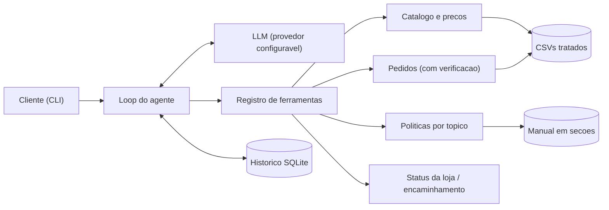

# 02 — Design

## Visão geral
Agente com **function calling**: o LLM decide quando consultar ferramentas tipadas; toda regra de negócio é código Python determinístico. Dados estruturados ficam em memória (pandas) carregados dos CSVs; o manual de políticas é pré-processado em seções e consultado por tópico.



### Por que esta abordagem
- **Function calling em vez de SQL gerado pelo LLM**: base pequena, e ferramentas tipadas garantem a verificação de titular (LGPD) e as regras de preço; não há consulta arbitrária a dados de clientes.
- **Seções do manual em vez de RAG vetorial**: o manual tem 8 páginas com seções numeradas; busca por tópico é exata, testável e sem infraestrutura. RAG vetorial passa a valer com um corpus maior (ver Limitações no README).
- **Loop próprio em vez de framework de agentes**: poucas dependências, controle total do fluxo e fácil de testar com LLM roteirizado.

## Estrutura
```
src/emporio/
  config.py            # env, caminhos, relógio injetável, fuso America/Campo_Grande
  data/                # carga e tratamento dos CSVs, repositórios
  policies/            # extração do PDF em seções + consulta por tópico
  domain/              # regras puras: pricing, installments, shipping, returns, store_hours
  tools/               # schemas + implementações das ferramentas + registro
  agent/               # cliente LLM, prompt de sistema, loop
  history/             # persistência SQLite
  cli.py
tests/                 # unit + integração (sem rede)
evals/                 # cenários contra o LLM real (opcional)
examples/conversas/    # transcrições reais
data/raw/  data/processed/
```

## Tratamento de dados
| Item | Tratamento |
|---|---|
| `products.specs` | JSON → dict; as chaves variam por categoria (violões e ukuleles têm `top`, `scale`, `electronics`; guitarras e baixos têm `body`; baterias têm `pieces`) |
| `products.status` | `active`, `discontinued`, `coming_soon`; combinado com o estoque em um enum de disponibilidade, com o `status` tendo precedência |
| `promotions` | só `is_active = 1`; no máximo uma ativa por produto (validado na carga — hoje 4 ativas, nos produtos 90, 94, 121 e 127) |
| `categories` | 9 categorias, mas só 1, 2, 3, 4, 5 e 9 têm produtos; sopros e cordas orquestrais ficam sem item (ver RF-09) |
| `orders.payment_method` | `credit_6x` → forma de pagamento + número de parcelas |
| `orders.total_brl` | usado como está, nunca recalculado a partir dos itens (pedidos 3 e 20 divergem por desconto); promoção ativa hoje não se aplica a pedido antigo |
| `customers` | e-mail normalizado em minúsculas, telefone só dígitos para comparação; e-mail NÃO é chave única (clientes 11 e 43) |
| Manual | seções numeradas → `data/processed/politicas.json` (gerado por comando e versionado) |

## Ferramentas do agente
| Ferramenta | Entrada | Saída |
|---|---|---|
| `search_products` | `query?`, `category?`, `max_price?`, `min_price?`, `only_available=true`, `limit=8` | lista com id, nome, categoria, preço final, promoção e disponibilidade; quando a categoria existe mas não tem item, lista vazia com `category_empty=true` |
| `get_product_details` | `product_id` ou `name` | detalhes, specs, disponibilidade, condições de pagamento (RF-03) e alternativas se indisponível (RF-04) |
| `list_categories` | — | categorias com a contagem de itens compráveis |
| `get_order_status` | `order_id`, `email_or_phone` | pedido verificado + elegibilidade de troca/devolução, ou erro `verification_failed` sem nenhum dado do pedido |
| `get_policy` | `topic` (enum) | texto da seção do manual |
| `get_store_status` | — | aberto ou fechado agora e próxima abertura |
| `create_handoff` | `reason`, `summary`, `contact?` | protocolo + prazo de 24 horas úteis |

Tópicos de `get_policy`: `about_store`, `contact_address`, `hours`, `payment`, `returns_exchanges`, `shipping`, `tracking`, `promotions`, `warranty`, `privacy`, `service_scope`.

Erros de ferramenta retornam `{"error": código, "message": texto}` para o LLM tratar.

## Regras de domínio
- **Promoção**: preço final = tabela × (1 − desconto). Sempre exibida com preço original e percentual (manual 6.2).
- **PIX**: 5% sobre o preço de tabela, apenas se não houver promoção ativa (não cumulativo, manual 6.2).
- **Parcelamento**: maior `n` em 1..12 com parcela = total / n e: n ≤ 3 → parcela ≥ R$ 50; 4–6 → parcela ≥ R$ 80; 7–12 → parcela ≥ R$ 100. Total abaixo de R$ 50 → só à vista.
- **Pagamento combinado**: permitido para compras acima de R$ 2.000.
- **Frete**: Campo Grande grátis acima de R$ 500, senão R$ 35, 1 a 3 dias úteis, motoboy próprio; outras cidades por PAC (5 a 12 dias úteis), SEDEX (2 a 5) ou Jadlog (3 a 8), valor calculado no fechamento pelo CEP; instrumentos de grande porte com cotação individual; todos os envios com seguro.
- **Troca e devolução** — cada prazo tem sua própria data de referência:

  | Modalidade | Prazo | Conta a partir de | Fonte |
  |---|---|---|---|
  | Arrependimento (online) | 7 dias corridos | recebimento | manual 4.1 |
  | Troca por preferência | 7 dias corridos | recebimento | manual 4.3 |
  | Troca por defeito | 30 dias corridos | data da compra (`order_date`) | manual 4.2 |
  | Garantia legal (CDC) | 90 dias corridos | recebimento | manual 8.1 |

  Recebimento = `estimated_delivery` dos pedidos `delivered` (P-04). Pedido não entregue: nenhum prazo contado do recebimento começou. Depois dos 30 dias por defeito vale a garantia legal e, encerrada ela, a garantia do fabricante com intermediação opcional da loja. Itens não elegíveis (manual 4.4): personalização sob encomenda, liquidação com aviso de venda final e boquilhas de sopro.
- **Horário**: seg a sex 09:00–18:00, sáb 09:00–13:00, domingo e feriados fechado, no fuso `America/Campo_Grande`. Feriados não são modelados (P-06); datas especiais podem ter horário estendido.

## Agente
- **Prompt de sistema**: persona (manual 7.1), data e hora atual da loja vindas do relógio, regras de uso de ferramentas (nunca falar de preço, estoque, prazo, condição de pagamento ou status sem consultar), escopo, LGPD e formato curto para chat. Enxuto por causa do RNF-08.
- **Loop**: até 5 rodadas de ferramenta por turno. **Uma chamada de ferramenta por rodada**: o `openai/gpt-oss-120b` no Groq não suporta tool calling paralelo (documentação do provedor), então o loop é sequencial — ainda assim percorre a lista de `tool_calls` para não depender desse detalhe do provedor.
- **Cliente LLM**: SDK `openai` com `base_url` configurável (compatível com OpenAI, Groq e Ollama). Variáveis: `LLM_BASE_URL`, `LLM_API_KEY`, `LLM_MODEL`, `LLM_TIMEOUT_SECONDS`. Padrão `openai/gpt-oss-120b` na camada gratuita do Groq; alternativa local com Ollama (`llama3.2:3b`) trocando só o `.env`. Tolera o campo `reasoning` na resposta e não usa `reasoning_format=raw` junto com ferramentas, combinação que o provedor rejeita com 400. Trata `429` respeitando o `retry-after`, com um número fixo de tentativas.
- **Histórico**: tabela `messages(session_id, seq, role, payload_json, created_at)`; mensagens de ferramenta persistidas para manter o contexto. O que vai ao LLM é uma janela das mensagens mais recentes (RNF-08); a sessão completa continua no banco.

## Limites do provedor que afetam o design
Camada gratuita do Groq para `openai/gpt-oss-120b`: 30 requisições por minuto, 1.000 por dia, 8.000 tokens de entrada por minuto e 200.000 por dia. Como um turno com ferramenta gasta pelo menos duas requisições, o orçamento de contexto (RNF-08) e a pausa entre cenários nos evals são requisitos, não otimização.

## Testes
- Unitários: domínio, carga de dados, extração de políticas e cada ferramenta.
- Integração: loop do agente com LLM roteirizado (sequência fixa de chamadas de ferramenta e respostas).
- Evals (`evals/`): cenários com a ferramenta esperada e os fatos que devem aparecer; rodam só com chave configurada, com pausa entre cenários.
